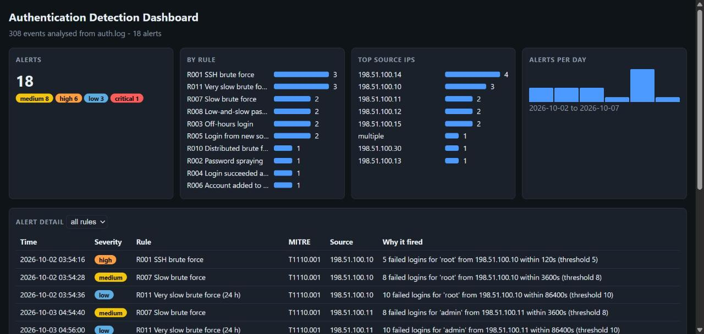

# Dashboard guide

The dashboard is a **single self-contained HTML file**: no server, no network calls, no dependencies. Alert data is embedded in the page, so it can be emailed or opened offline.



## Generate it

```
python -m detector.cli sample_data/auth.log --html sample_data/dashboard.html
# Windows Security event export:
python -m detector.cli security.csv --format windows --html windows_dashboard.html
```

Open the file in any browser (double-click it). It follows the system light/dark theme and works on a phone-width screen.

## What each panel shows

| Panel | Meaning | Use it to |
|---|---|---|
| **Alerts** | Total alerts, with a severity breakdown (critical / high / medium / low) | Gauge overall volume and urgency |
| **By rule** | Alerts per rule (ID + name) | Spot a noisy rule that needs tuning |
| **Top source IPs** | Sources with the most alerts. `multiple` = a distributed attack on one account (R010) | Pick IPs to block or investigate |
| **Alerts per day** | Daily alert counts (hover a bar for the exact number) | See when activity started or spiked |
| **Alert detail** | Every alert: time, severity, rule, MITRE technique, source, and a plain-English reason | Triage; use the dropdown to filter to one rule |

**Click any row** to expand the evidence: the exact raw log lines that triggered the alert, so a reviewer can verify it without opening the log.

## Severity scheme

| Severity | Rules | Rationale |
|---|---|---|
| critical | R004 login succeeded after repeated failures | Probable account compromise |
| high | R001, R002, R006, R010 | Active attack or privilege change |
| medium | R003, R005, R007, R008 | Suspicious, often needs context |
| low | R009, R011 | Informational or very slow signals |

## Reading an example

`R004 Login succeeded after repeated failures - login for 'heidi' succeeded from 198.51.100.14 after 7 failures in 600s`
means the brute force worked. R001 (brute force) fired a few seconds earlier for the same source, so these two alerts together tell the whole story: attack, then success. Expand the row to see the 8 log lines.

## Tuning from the dashboard

If one rule dominates the **By rule** panel, adjust it without editing code:

```
python -m detector.cli auth.log --set R003.allow_users=ops_night --set R005.ignore_cidrs=172.16.0.0/16 --html out.html
```

`allow_users` exempts known night-shift accounts from R003; `ignore_cidrs` tells R005 about a known VPN pool. Thresholds for any rule can be overridden the same way (`--set R001.threshold=8`).

## Limits

The dashboard is a static snapshot of one analysis run; it does not stream live logs. Alert counts are per detection, so one attack can raise several related alerts (see the example above).
